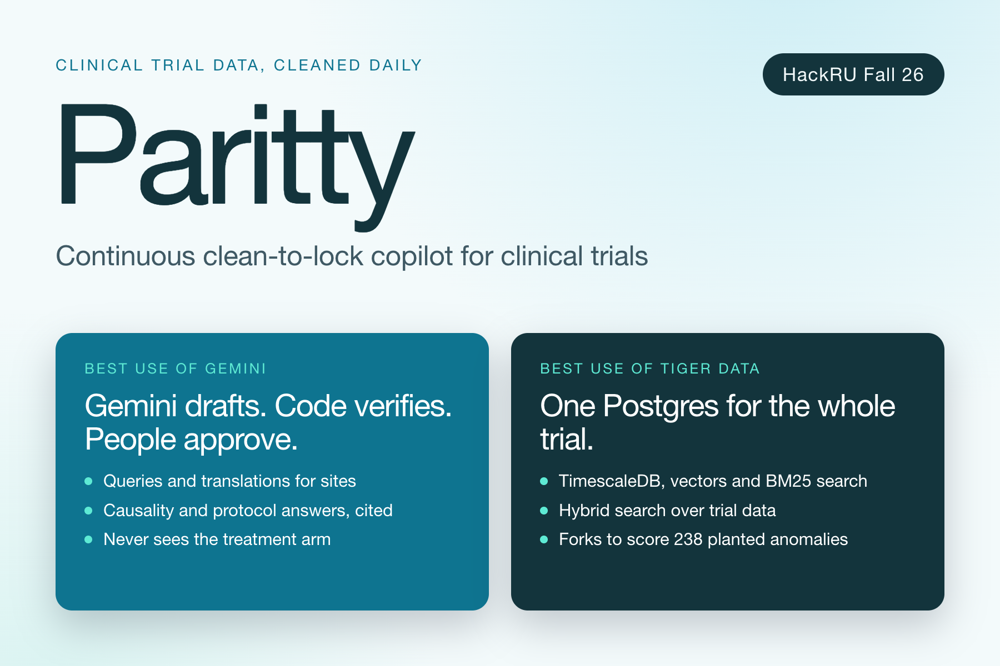
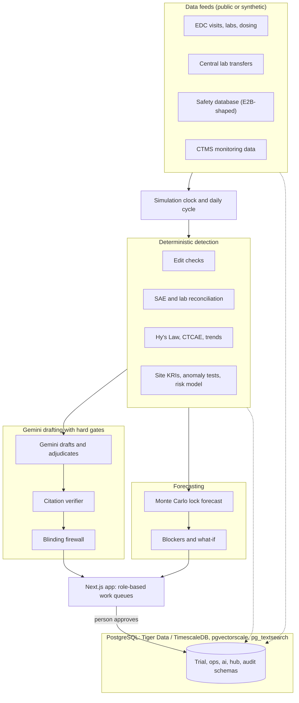

<p align="center">
  
</p>

# Paritty

**Continuous clean-to-lock copilot for clinical trials.** Built for HackRU Fall 2026 (Regeneron Clinical Challenge, Best Use of Gemini, Best Use of Tiger Data). Paritty was called LockStep during development, so some file names and the build spec still use the old name.

> Lock the database on the day, not 36 days after.

- [The problem](#the-problem)
- [What Paritty does](#what-paritty-does)
- [How Gemini and Tiger Data are used](#how-gemini-and-tiger-data-are-used)
- [Tech stack](#tech-stack)
- [Architecture](#architecture)
- [Getting started](#getting-started)
- [Using Paritty](#using-paritty)
- [Configuration](#configuration)
- [Make commands](#make-commands)
- [Data](#data)
- [Safety and regulatory guardrails](#safety-and-regulatory-guardrails)
- [Testing and evaluation](#testing-and-evaluation)
- [Project layout](#project-layout)
- [Documentation](#documentation)
- [Contributing](#contributing)

## The problem

Before trial data can go to a regulator, the database must be locked: every record frozen, checked and reconciled. Most teams start cleaning only after the last patient's last visit (LPLV). The industry average from LPLV to lock is **36+ days** (Tufts Center for Drug Development), and for a blockbuster drug each day of delay can cost up to **$1,000,000** in lost patent life. Patients wait longer for therapies in the meantime.

Paritty replaces the end-of-study scramble with a daily cycle. New visits are audited within 24 hours of entry, queries are drafted while the site still remembers the visit, the clinical and safety databases are reconciled every day, and a simulation keeps a running forecast of the lock date.

| Traditional trial | Paritty |
|---|---|
| Data sits unchecked for months | New visits are audited within 24 hours of entry |
| Queries go to sites months after the visit | Queries are drafted immediately, while memories are fresh |
| Manual reconciliation between databases | Fuzzy reconciliation runs daily |
| Guessing the final lock date | A Monte Carlo simulation projects the lock date |

## What Paritty does

The demo study is a synthetic-augmented Phase III Alzheimer's trial: 404 patients across 24 sites, with a main EDC database, an external central lab feed, and a separate safety database.

| Area | What you get |
|---|---|
| **Today** | A work queue for each of five roles (data manager, medical monitor, central monitor, study lead, unblinded statistician): decisions waiting, the most likely lock date, and how many lock conditions are met. |
| **Data checks and queries** | 25+ deterministic edit checks (chronology, physiological limits, protocol adherence, duplicates). Each issue gets a critical-to-quality priority, so an unreported death outranks a misspelled surname. Queries move through Draft, Approved by a human, Sent, Answered and Closed (or Reopened), and can be translated for international sites with numbers, dates and IDs verified. |
| **Safety report matching** | Matches the same serious adverse event across the EDC and the safety database ("Acute myocardial infarction" and "Heart attack"), triages differences as acceptable, actionable or critical, tracks safety case versions, and drafts a causality assessment with cited evidence. |
| **Lab matching** | Compares clinic and central lab results and catches unit mix-ups such as mg/dL versus mmol/L and stale feeds. |
| **Medical review** | An eDISH liver-safety plot for Hy's Law, CTCAE lab grading, lab trends, and review notes drafted for a medical monitor to sign. |
| **Site risk** | Eight key risk indicators, six statistical anomaly tests and a machine-learning risk score from 0 to 100. Drafts visit agendas, follow-up letters and a scorecard PDF for a person to approve. |
| **Lock readiness** | A Monte Carlo forecast (P10, P50, P90) rerun every simulated day, a ranking of blockers by days saved, a what-if sandbox, and a backtest. |
| **Ask the protocol** | Answers eligibility and protocol questions with exact quotes. Questions that need medical judgment are escalated to the Medical Monitor instead of guessed. |
| **Data hub** | Resolves conflicting subject and site identifiers to one record, catalogs the study tables, and turns plain-English questions into guarded read-only SQL. |
| **Suggested actions** | A data-manager agent proposes actions scored by the what-if forecast. A person approves each one. |
| **Accuracy tests** | An evaluation harness scores every detector against planted anomalies on a database fork. |

A simulation clock lets you advance the trial by 1, 7 or 30 days. Future visits are released from a staging area into the live tables, and the daily cycle runs checks, reconciliation, drafting and forecasting.

## How Gemini and Tiger Data are used

### Gemini: drafts and adjudicates, never decides

Detection is deterministic code. Gemini drafts and judges, and everything it says is checked.

1. Deterministic checks find the issue, with no AI involved.
2. Gemini drafts the query, translation, note, letter, causality assessment or protocol answer.
3. A deterministic verifier checks every quote and row ID against the database. Each claim must cite a table, primary key and column. A claim that fails verification is blocked.
4. A person approves before anything leaves the platform.

Where Gemini works:
- Drafts queries and translates them for sites.
- Adjudicates borderline term matches (for example "heart attack" versus "myocardial infarction", where embedding similarity alone is a weak signal).
- Answers protocol questions with exact quotes, escalating when confidence is low.
- Assesses causality with cited evidence.
- Proposes read-only SQL for plain-English questions, which a guard restricts to a single `SELECT` over allow-listed views, run in a read-only transaction with a timeout and row limit.
- Embeds text for semantic search (`gemini-embedding-2`).
- Words the rationale for suggested actions, after numbers are checked against the candidate.

Gemini never sees the treatment arm and never produces executable logic. Without a key, every workflow falls back to deterministic templates.

### Tiger Data: one Postgres for the whole trial

- **TimescaleDB** hypertables hold visits and labs over time.
- **pgvectorscale** holds embeddings, and **pg_textsearch** provides BM25. Hybrid search merges both result lists (reciprocal rank fusion), so one query finds meaning and exact terms such as drug names and lab limits.
- **Database forks** power the evaluation harness. It forks the database, runs a multi-week simulation, scores it against the planted answer key and deletes the fork, so the demo data is never touched. On Tiger Cloud a fork is a whole new service (`tiger service fork`); locally it is a fast `CREATE DATABASE ... TEMPLATE` copy.
- The same migrations run unchanged on **Tiger Cloud** and on local Docker. See [docs/TIGER.md](docs/TIGER.md) for setup, measurements and limits.

## Tech stack

| Layer | Technology |
|---|---|
| Frontend | Next.js 16 (App Router), React 19, TypeScript, Tailwind CSS 4, TanStack Query, Recharts |
| Backend | Python 3.12, FastAPI, Uvicorn, Pydantic, SQLAlchemy, psycopg 3, Server-Sent Events |
| Data and ML | pandas, NumPy, SciPy, scikit-learn (site risk model), lifelines, RapidFuzz (fuzzy matching), PyArrow |
| LLM | Google Gemini via `google-genai`: a fast model, a strong model and `gemini-embedding-2` (names set in `.env`) |
| Database | PostgreSQL with TimescaleDB, pgvectorscale and pg_textsearch. Local: `timescale/timescaledb-ha:pg17` in Docker. Cloud: Tiger Cloud |
| Reports | ReportLab (site scorecard PDFs) |
| Tooling | uv (Python), npm, Docker Compose, pytest, ESLint, GitHub Actions |

## Architecture



## Getting started

Everything below runs locally with **no accounts and no API keys**. By default Gemini calls are served from recorded responses (see [LLM modes](#llm-modes)).

### Prerequisites

| Tool | Version | Notes |
|---|---|---|
| Docker Desktop | recent | Must be running before `make db` |
| uv | current | Installs Python 3.12 for the project |
| Node.js | 22 or newer | |
| psql | any | Only for the manual database commands in `docs/SETUP.md` |

Commands were tested on macOS (Apple silicon). Linux should work with your package manager in place of Homebrew.

### Quick start

```bash
git clone https://github.com/moh0405/parity
cd parity
cp .env.example .env          # defaults are the local setup
make setup db migrate seed    # install deps, start TimescaleDB on :5433, build the study data
make demo                     # API on :8000, web app on :3000
```

`make seed` downloads the public CDISC pilot data, builds the 24-site study, plants known errors, trains the site risk model and snapshots a golden template database. It needs internet access and takes a few minutes.

Open http://localhost:3000. The API health check is at http://localhost:8000/api/health, and FastAPI serves interactive API docs at http://localhost:8000/docs.

Full setup from a clean machine, including a Gemini key, Tiger Cloud and troubleshooting, is in [docs/SETUP.md](docs/SETUP.md).

## Using Paritty

1. **Pick a role** in the top bar. Each role starts from its own queue on **Today**, and the sidebar shows the pages that role works in. Everything else is under "Other areas". Click "Take the 2-minute tour" for a guided walkthrough.
2. **Advance the trial** with the header buttons (+1 day, +7 days, +30 days) or `POST /api/sim/advance {"days": 30}`. New visits arrive, checks run, queries and reconciliation items are drafted, and the forecast updates. `make reset` returns to the seeded state (study day 60).
3. **Work the queue:**
   - *Data manager:* review drafted queries at `/queries`, approve or close them, and work the matches at `/recon/sae` and `/recon/labs`. Approving is the only way a query leaves the platform.
   - *Medical monitor:* open `/medical`, `/medical/liver` (eDISH) and `/medical/trends`, review drafted notes, and ask protocol questions at `/ask`.
   - *Central monitor:* check `/sites` for risk scores and `/sites/visit-plan` for proposed visits, calls and drafted agendas and letters.
   - *Study lead:* see `/agent` for suggested actions and `/` for lock readiness, blockers and what-ifs.
   - *Unblinded statistician:* the only role that can see unblinded data. Every access is audit-logged.
4. **Explore the data** at `/hub` (crosswalk, catalog, natural-language questions), `/search` (term search) and `/evals` (accuracy tests).

| Page | Route |
|---|---|
| Today | `/today` |
| Lock readiness | `/` |
| Queries to sites | `/queries` |
| Data checks | `/checks` |
| Safety report matching | `/recon/sae` |
| Lab matching | `/recon/labs` |
| Medical review, liver safety, lab trends | `/medical`, `/medical/liver`, `/medical/trends` |
| Ask the protocol | `/ask` |
| Site risk, visit plan | `/sites`, `/sites/visit-plan` |
| Suggested actions | `/agent` |
| Data hub, term search, accuracy tests | `/hub`, `/search`, `/evals` |

### LLM modes

| `LLM_MODE` | Behaviour |
|---|---|
| `replay` (default) | Serves recorded Gemini responses from `backend/fixtures/llm_cache`. A miss falls back to deterministic templates. No key needed. |
| `record` | Calls Gemini and caches each response. Needs `GEMINI_API_KEY`. `make record-llm` records the 60-day demo. |
| `live` | Calls Gemini on every request. Needs `GEMINI_API_KEY`. |

The Gemini free tier is rate-limited (a drafted query takes about 15 seconds), so tests and ordinary development should use `LLM_MODE=replay LLM_QUERY_DRAFTS=0`.

### Running on Tiger Cloud

Local Docker is the default. To run the app or the evaluation harness on Tiger Cloud, install the Tiger CLI, create a service, then set `DATABASE_URL`, `EVAL_ADMIN_URL`, `GOLDEN_SERVICE_ID` and `FORK_BACKEND=tiger` in `.env`. The exact sequence is in [docs/SETUP.md](docs/SETUP.md) (part C), and the limits (the free plan allows two services, so an eval needs one free slot) are in [docs/TIGER.md](docs/TIGER.md).

## Configuration

Copy `.env.example` to `.env` (gitignored). Never commit keys.

| Variable | Default | Purpose |
|---|---|---|
| `DATABASE_URL` | local Docker on `:5433` | Application database |
| `EVAL_ADMIN_URL` | local Docker on `:5433` | The only login that can read the `answer_key` schema |
| `FORK_BACKEND` | `template` | `template` (local copy) or `tiger` (Tiger service fork) |
| `GOLDEN_SERVICE_ID` | empty | Tiger service that eval forks are taken from |
| `LLM_MODE` | `replay` | `live`, `replay` or `record` |
| `GEMINI_API_KEY` | empty | Only needed for `live` or `record` |
| `GEMINI_FAST_MODEL` | `gemini-flash-latest` | Drafting and adjudication |
| `GEMINI_STRONG_MODEL` | `gemini-pro-latest` | Harder reasoning tasks |
| `GEMINI_EMBED_MODEL` | `gemini-embedding-2` | Embeddings |
| `EMBED_DIM` | `768` | Embedding dimension |
| `SEED` | `42` | Makes the seeded data deterministic |
| `SIM_START_DAY` | `60` | Study day the demo starts on |

## Make commands

| Command | What it does |
|---|---|
| `make setup` | Install backend (`uv sync`) and frontend (`npm ci`) dependencies |
| `make db` | Start TimescaleDB in Docker (a no-op when `.env` points at Tiger) |
| `make migrate` | Apply the numbered SQL migrations in `backend/app/db/migrations` |
| `make seed` | Download public data, build the study, plant errors, build the protocol and search index, train the risk model, snapshot the golden template |
| `make demo` | Start the API on `:8000` and the web app on `:3000` |
| `make test` | Run the backend tests (database tests skip if the database is unseeded) |
| `make reset` | Reset the simulation to the seeded state (day 60) |
| `make golden` | Reset and rebuild the eval template database |
| `make eval SCENARIO=smoke` | Run an evaluation scenario on a database fork |
| `make score-checks` | Score edit-check recall against planted errors (after a long advance) |
| `make record-llm` | Record Gemini responses for the demo (needs `GEMINI_API_KEY`) |

After every `git pull`, run `make setup && make migrate && make golden`.

## Data

All data is public or synthetic. **No real patient or site data is used.**

- **EDC base:** the public CDISC SDTM/ADaM pilot project (CDISCPILOT01).
- **Protocol text:** eligibility criteria quoted from ClinicalTrials.gov record NCT00505167, plus a synthetic protocol summary marked `[SYNTHETIC]`. Real hospital locations are not used.
- **Safety payload shape:** modelled on openFDA `drug/event`.
- **Synthetic parts:** 7 extra sites, site names and cities, date shifts, the mock lab, safety, CTMS and IRT systems, and every planted problem.
- **Planted problems:** 238 recorded plants in a schema the detectors cannot read, covering edit-check errors, lab mismatches, SAE discrepancies, Hy's-Law-pattern subjects, a site with creeping ALT, a rare-AE cluster and hub data-quality problems.

The pipeline, license notes and what is synthetic are documented in [DATA.md](DATA.md).

## Safety and regulatory guardrails

These rules hold across the codebase (full text in [CLAUDE.md](CLAUDE.md)):

1. **Human in the loop.** Every generated check, query, correction, note, letter, agenda, eligibility answer and agent action needs a person's approval. Auto-approval exists only for the simulator and is audit-logged.
2. **Blinding.** The treatment arm lives only in `unblinded.randomization`. It never appears in prompts, evidence, charts or blinded API responses.
3. **Neutral wording.** User-facing text says "potential", "needs review" and "reason to look", never accusations.
4. **Deterministic detection, verified AI.** Gemini drafts and adjudicates. Every claim carries citations and passes the verifier or is blocked. Gemini never produces executable logic.
5. **Answer key isolation.** App and detector code never read the `answer_key` schema. Only the evaluation scorer and the simulator's world model can, through `eval_admin`.
6. **Audit trail.** Every state change writes to `audit.log`.

## Testing and evaluation

```bash
make test                                              # backend tests (pytest)
cd frontend && npx next typegen && npx tsc --noEmit && npm run lint
```

CI (`.github/workflows/ci.yml`) runs the frontend type check and lint, and the backend migrations, seed and tests against a TimescaleDB service.

Run the suite on your own database copy, not on one someone else is using (see [docs/SETUP.md](docs/SETUP.md), part A step 6).

The evaluation harness (`backend/app/evals`) forks the database, applies a scenario from `backend/scenarios` (`smoke`, `full`, `sites`, `agent`, `forecast_backtest`), and scores detectors against the planted answer key. Scoring scripts for individual modules live in `backend/scripts` (`score_checks`, `score_sae_recon`, `score_lab_recon`, `score_sites`, `score_causality`, `score_eligibility`). Honest results, caveats and unmeasured paths are recorded in [docs/DECISIONS.md](docs/DECISIONS.md).

## Project layout

```
backend/
  app/          api, checks, queries, sim, recon, medical, sites, forecast, protocol,
                hub, agent, evals, llm, verification, search, audit, db (migrations)
  scripts/      seed pipeline and scorers
  tests/        pytest suite
  scenarios/    evaluation scenarios (YAML)
  fixtures/     recorded Gemini responses (llm_cache)
frontend/       Next.js app (app/ routes, components/)
data/protocol/  synthetic protocol and Q&A
docker/         database init script
docs/           setup, decisions, Tiger Cloud, work split, project explainer
```

## Documentation

| File | What it covers |
|---|---|
| [docs/SETUP.md](docs/SETUP.md) | Setup from a clean machine, Gemini key, Tiger Cloud, troubleshooting |
| [docs/TIGER.md](docs/TIGER.md) | Running on Tiger Cloud: forks, limits, cost |
| [docs/PROJECT_EXPLAINER.md](docs/PROJECT_EXPLAINER.md) | Plain-English guide to every module |
| [docs/DECISIONS.md](docs/DECISIONS.md) | Deviations from the spec, results, known issues |
| [DATA.md](DATA.md) | Data sources, pipeline and synthetic elements |
| [LOCKSTEP_BUILD_SPEC.md](LOCKSTEP_BUILD_SPEC.md) | The full design and milestones |
| [CLAUDE.md](CLAUDE.md) | Rules and conventions for Claude Code sessions |
| [CONTRIBUTING.md](CONTRIBUTING.md) | Branches, migrations and collisions |

A 4-minute walkthrough video and a 21-second launch video are on the `brag-video-3min` and `brag-video` branches.

## Contributing

Work on a branch (`feat/<topic>` or `fix/<topic>`), keep PRs small, add a test for every rule you add, and record deviations in `docs/DECISIONS.md`. Migrations are additive and numbered, with ranges split between contributors. Details are in [CONTRIBUTING.md](CONTRIBUTING.md).
